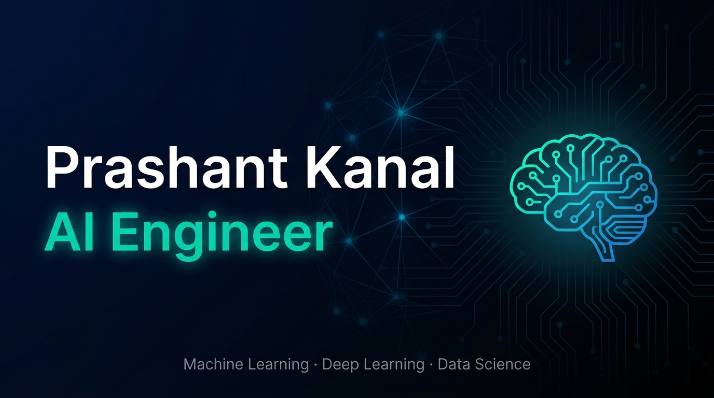

<!-- ═══════════════════════════ HEADER ═══════════════════════════ -->
<p align="center">
  
</p>

<h1 align="center">Hi 👋, I'm Kanal Pawadi Piragond</h1>
<h3 align="center">Applied AI Engineer · Generative AI / ML · Full-Stack Developer</h3>

<p align="center">
  
</p>

<p align="center">
  <a href="https://www.linkedin.com/in/pawadi-kanal-0665472a2/"></a>
  <a href="mailto:kanalpawadi@gmail.com"></a>
  <a href="https://github.com/kanalpawadi"></a>
  <a href="https://www.instagram.com/kanal.prashant/"></a>
  <a href="./resume/Kanal_Pawadi_Resume.pdf"></a>
</p>

<p align="center">
  
  
  
  
</p>

---

## 👨‍💻 About Me

Final-year **AI & Data Science** undergraduate (**CGPA 9.04/10**) who builds **Generative AI, RAG and applied ML systems that ship to real users**. I've delivered production prototypes spanning LangChain + Groq RAG pipelines, multilingual NLP risk classification, time-series forecasting, and a live in-browser SQL learning platform now used across my campus.

**AWS Academy Data Engineering certified** · **Published Springer researcher** · **First-prize winner** of a global AI student competition.
Currently seeking an **Applied AI Engineering internship** that converts into a full-time **AI Engineer** role.

```python
class KanalPawadiPiragond:
    role        = "Applied AI Engineer | Generative AI / ML | Full-Stack"
    education   = "B.Tech AI & DS (Hons: Big Data Analysis) · CGPA 9.04/10"
    college     = "DKTE Society's Textile & Engineering Institute, Ichalkaranji (NAAC A+)"
    batch       = "2023 – 2027"
    location    = "Sangli, Maharashtra, India 🇮🇳"

    focus       = ["RAG Systems", "LLM Agentic Workflows", "NLP", "Time-Series ML",
                   "Retrieval Evaluation", "Full-Stack AI Products"]

    highlights  = {
        "🏆 Award"      : "First Prize — GI-AI-SC 2026, MIT World Peace University",
        "📄 Research"   : "Lead Author — Springer ICDAM-2026 (DigiHeR)",
        "☁️ Cert"       : "AWS Academy Data Engineering (40 hrs)",
        "🥈 Hackathon"  : "Finalist — National Level Hackathon, IIT Roorkee",
        "🔥 DSA"        : "LeetCode 250+ problems · 100-day streak",
    }

    looking_for = "Applied AI Engineering internship → full-time AI Engineer"
```

---

## 📈 Impact at a Glance

<div align="center">

| ⚡ **30%** | 🎯 **100%** | 🤖 **35%** | 📉 **22%** | 🧠 **0.96 F2** | 📐 **4.6–5.9 mm** |
|:---:|:---:|:---:|:---:|:---:|:---:|
| lower RAG latency vs. OpenAI baseline | semantic retrieval accuracy on dynamic docs | FAQ support workload automated | lower forecasting MAE vs. baseline | on 530k-report safety corpus | RMSE in 3D heritage reconstruction |

</div>

---

## 💼 Work Experience

### 🤖 Generative AI Engineer Intern — Sunbeam Institute, Pune
`Dec 2025` &nbsp;•&nbsp; `LangChain` `Groq API` `ChromaDB` `Selenium` `Streamlit Cloud` `REST APIs`

- Built and shipped **RAG chatbots** with LangChain and the Groq API, cutting inference latency **30%** versus an OpenAI baseline.
- Automated document ingestion with **Selenium + ChromaDB**, reaching **100% semantic retrieval accuracy** on dynamic source documents.
- Deployed production AI apps via **Streamlit Cloud** and **REST APIs**, automating **35%** of the FAQ support workload.

---

## 🚀 Featured Projects

<table>
<tr>
<td width="50%" valign="top">

### 🛡️ PRAHARI — SIF Precursor Detection Engine
**NLP / Machine Learning**

`Python` `HF Transformers (multilingual-E5)` `scikit-learn` `FastAPI` `React` `TypeScript` `Plotly` `SQLite`

- Classifies workplace safety reports into **7 risk classes** using the EEI safety model
- Calibrated classifiers on a **530k-report corpus** → **0.96 F2** on high-energy hazard & serious-injury detection
- Handles **Hindi, Assamese & code-mixed** text; asks the reporter a clarifying question instead of guessing when evidence is missing
- FastAPI + React dashboard with evidence highlighting & human-review loop — **~32 ms/report on CPU**

</td>
<td width="50%" valign="top">

### 🎮 SQLQuest — Gamified In-Browser SQL Platform
**Full Stack · 2026** &nbsp;·&nbsp; 🟢 *Live on campus*

`TypeScript` `React` `Vite` `SQLite WASM (sql.js)` `Supabase` `Vercel`

- Gamified SQL learning platform **in active use by students & faculty at DKTE**
- Live SQL editor that runs **fully client-side** via WebAssembly — no backend needed
- **215+ practice questions**, adaptive difficulty, and an error checker that names the **exact SQL mistake** a student made

</td>
</tr>
<tr>
<td width="50%" valign="top">

### ⚡ High-Speed RAG Chatbot
**Sunbeam Institute · Dec 2025**

`Python` `LangChain` `Groq API` `ChromaDB` `Selenium` `Streamlit` `LLaMA 3`

- LangChain + **Groq LPU** RAG pipeline — **30% lower** response latency than OpenAI baseline
- Selenium → ChromaDB **auto-ingestion** pipeline for dynamic documents with **100% retrieval accuracy**
- Tuned prompt chains to eliminate hallucinated answers; Streamlit UI automated **35%** of FAQ support

</td>
<td width="50%" valign="top">

### 📦 AI-Powered Inventory Demand Forecasting
**Time-Series ML · 2026**

`Python` `ARIMA` `Prophet` `SQL` `Streamlit`

- **ARIMA + Prophet ensemble** for 14-day inventory forecasting — **22% lower MAE** vs. baseline
- Feature pipelines for **seasonality & trend decomposition**
- Streamlit dashboard on **live SQL queries**, driving an **18% reduction** in overstock cost

</td>
</tr>
<tr>
<td colspan="2" valign="top">

### 🎓 Clunite — Campus Event & Club Management Platform
**Final-Year Project · Ongoing** &nbsp; `Next.js 14` `React 18` `TypeScript` `Supabase` `PostgreSQL` `Tailwind CSS` `shadcn/ui` `Vercel`

- Full-stack platform with **dual dashboards** for students and organizers to discover, register for, and manage campus events and clubs
- **Secure PIN-based club verification**, real-time updates via Supabase, and type-safe forms with React Hook Form + Zod
- Organizer **analytics dashboard**, deployed on Vercel with Blob storage for media

</td>
</tr>
</table>

---

## 🏆 Achievements & Research

| | Achievement | Year |
|:---:|---|:---:|
| 📄 | **Published Researcher — ICDAM-2026 (Springer)** · Lead author of *"DigiHeR: Scalable AI-based Framework of Crowdsourced 3D Cultural Heritage Reconstruction with WebXR."* Designed an AI-driven IQA + SfM/MVS reconstruction pipeline achieving **4.6–5.9 mm RMSE**, **96%+ success rate**, and **85%+ cost reduction** vs. traditional methods. | Jun 2026 |
| 🥇 | **First Prize — Global Interdisciplinary AI Student Competition (GI-AI-SC), MIT WPU** · Led a 3-member team to ship a production-grade AI system in **48 hours**; built a Python pipeline that ingested, vectorized and indexed multi-format datasets in **under 60 seconds** at **95%+ semantic accuracy** during live judging. | 2026 |
| ☁️ | **AWS Academy Data Engineering** — 40 hours | Apr 2026 |
| 🥈 | **Finalist — National Level Hackathon, IIT Roorkee** · Competed among the top AI teams nationally. | 2025 |
| 💻 | **LeetCode 250+** problems (Java, C) — DP, Arrays, Hash Tables, Greedy · **100-day streak** | — |

---

## 🛠️ Tech Stack

**Languages**


**Generative AI & LLMs**


**Machine Learning, NLP & Data**


**Vector Stores & Retrieval**


**Backend, Frontend & APIs**


**Databases & Cloud**


**Tools & DevOps**


---

## 📊 GitHub Analytics

<p align="center">
  
  
</p>

<p align="center">
  
</p>

---

## 🎓 Education

| Degree | Institute | Score | Year |
|---|---|:---:|:---:|
| **B.Tech, AI & Data Science** <br/><sub>Honours: Big Data Analysis</sub> | DKTE Society's Textile & Engineering Institute, Ichalkaranji (NAAC A+) | **CGPA 9.04/10** <br/><sub>Honours CGPA 9.00/10</sub> | 2023 – 2027 |
| Class XII (HSC) | Maharashtra State Board | **71.80%** | 2022 |
| Class X (SSC) | Maharashtra State Board | **91.80%** | 2020 |

---

## 📜 Certifications & Leadership

- ☁️ **AWS Academy Data Engineering** — 40 hours (Apr 2026)
- 🧑‍💻 **Student Ambassador** — Let's Upgrade EdTech Platform
- 🤝 **Volunteer Lead** — Social Committee, DKTE
- 📣 **Social Media Lead** — DSSA Technical Association
- 🌍 **Languages** — English (Professional) · Hindi · Marathi · Kannada

---

## 🌐 Let's Connect

<p align="center">
  I'm actively looking for <b>Applied AI Engineering</b> internships and full-time <b>AI Engineer</b> roles.<br/>
  Open to collaborations on GenAI, NLP, ML research and full-stack AI products — let's build something impactful.
</p>

<p align="center">
  <a href="https://www.linkedin.com/in/pawadi-kanal-0665472a2/"></a>
  <a href="mailto:kanalpawadi@gmail.com"></a>
  <a href="https://www.instagram.com/kanal.prashant/"></a>
  <a href="./resume/Kanal_Pawadi_Resume.pdf"></a>
</p>


